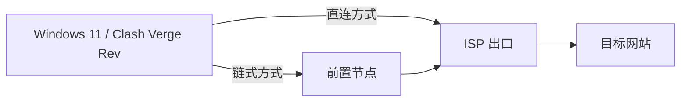

# Windows 11 上的 Clash Verge Rev ISP 代理配置教程

在 Clash Verge Rev 中使用 HTTP 或 SOCKS5 ISP 代理，可以选择直接连接 ISP，也可以让现有前置节点连接 ISP。本文分别给出完整配置与操作流程，最终出口均由所选 ISP 节点承担。

**仓库中的地址、用户名和密码均为虚构教学数据，不能直接用于联网。** 请在自己电脑上的副本中填写实际信息，不要把填写后的文件提交到公开仓库。

适用界面：Windows 11、Clash Verge Rev 2.5.x；配置语法使用 Mihomo 的 `dialer-proxy`。菜单名称随版本和语言略有差异，以所安装版本为准。文档核对日期：2026-10-25。

## 1. 选择连接方式

| 方式 | 连接顺序 | 需要准备的信息 |
| --- | --- | --- |
| ISP 直连 | 本机 → ISP → 目标网站 | ISP 地址、协议端口、用户名和密码 |
| 链式代理 | 本机 → 前置节点 → ISP → 目标网站 | 上述 ISP 信息，以及一条已经可用的前置节点 |

直连要求本地网络能够访问 ISP 服务端点。链式代理让前置节点承担到 ISP 的连接；浏览器最终查询到的应是 ISP 的出口地址，而不是前置节点的出口地址。[链式连接字段说明](https://wiki.metacubex.one/config/proxies/dialer-proxy/)

## 2. 示例文件和虚构参数

| 文件 | 用途 |
| --- | --- |
| [direct.example.yaml](examples/direct.example.yaml) | 包含 HTTP、SOCKS5 两个接入选项的 ISP 直连配置 |
| [chain.example.yaml](examples/chain.example.yaml) | 前置节点通过 `dialer` 组选择，再连接 ISP 的完整配置 |
| [字段说明](docs/configuration.md) | 节点、代理组、规则、DNS 和更新方式的说明 |

全文统一采用以下虚构数据：

| 项目 | 教学值 | 实际使用时如何填写 |
| --- | --- | --- |
| ISP 接入地址 | `203.0.113.20` | 供应商订单中提供的接入 IP 或主机名 |
| HTTP 代理端口 | `18080` | 订单中的 HTTP 代理端口 |
| SOCKS5 代理端口 | `1080` | 订单中的 SOCKS5 代理端口 |
| ISP 用户名 | `demo_isp_user` | 代理认证用户名，不一定等于网站登录账号 |
| ISP 密码 | `DemoOnly-Isp-Password` | 对应代理认证密码 |
| 前置服务器地址 | `198.51.100.10` | 已有前置节点的实际地址 |
| 前置节点名称 | `示例-前置节点` | 配置内的显示名称，引用它的地方须同步修改 |

`198.51.100.0/24` 和 `203.0.113.0/24` 是文档示例地址段；`.example` 是文档示例域名用途。这里故意不使用真实服务端点。[地址段依据](https://www.rfc-editor.org/rfc/rfc5737)

供应商可能同时显示接入网关和出口 IP。填写 `server` 时使用供应商指定的**接入端点**；验证时再核对该账号预期的**出口 IP**，不要假设两者一定相同。

## 3. 共同准备步骤

1. 从 [Clash Verge Rev 官方发布页](https://github.com/clash-verge-rev/clash-verge-rev/releases) 安装适合 Windows 的版本；已经安装时可继续使用兼容版本。
2. 保留当前正常工作的订阅。为本教程单独创建一个本地配置，不覆盖原订阅或全局脚本。
3. 下载需要的示例文件，在本机副本内填写真实参数。文件后缀保持 `.yaml`，使用 UTF-8 编码、空格缩进和英文冒号。
4. 进入 **订阅 → 新建 → 本地**，填写名称，例如“ISP 直连”或“ISP 链式”，通过“选择文件”导入已填写的 YAML，然后保存。
5. 若已创建空白本地配置，打开该配置的文件编辑入口，替换为相应示例的完整内容后保存。编辑入口可能称为“编辑文件”或“编辑配置”；不要只打开名称、描述等属性表单。
6. 本教程由 YAML 管理该配置的 DNS。确认 **这个新配置** 的“DNS 覆写”关闭；在按订阅保存开关的版本中，核对目标订阅标识，不要顺带修改其他订阅。具体 DNS 所属层见[字段说明](docs/configuration.md#dns-由谁管理)。
7. 先完成保存，再进入后续启用步骤。保存文件与启用配置是两个不同动作；不要把保存成功当作已经连通。

如果所在版本的 DNS 覆写只提供全局开关，先明确其他订阅是否依赖它，再选择统一使用界面 DNS 或统一使用配置 DNS，不照搬按订阅的操作。

## 4. 方式一：直接使用 ISP

### 4.1 填写节点

使用 [direct.example.yaml](examples/direct.example.yaml)。文件包含：

- `ISP-HTTP`：通过 HTTP 代理端口连接 ISP。
- `ISP-SOCKS5`：通过 SOCKS5 代理端口连接同一个 ISP。
- `ISP-出口`：手动选择其中一种协议的代理组。

将两个节点中的 `server`、`port`、`username`、`password` 替换为订单中的真实信息。若供应商只支持一种协议，可删除另一节点，并同步删除 `ISP-出口` 中对它的引用。

HTTP 代理能够通过 CONNECT 转发 HTTPS 网站，不代表“本机到代理服务器”这一段必须使用 TLS。只有供应商明确提供 TLS 加密的代理接入时，才按其说明设置 `tls: true`、端口和服务器名称；不要为了消除错误关闭证书验证。[HTTP 节点语法](https://wiki.metacubex.one/config/proxies/http/)

### 4.2 确认代理组与规则

配置已经设置 `select` 手动选择组。默认顺序中 HTTP 在前、SOCKS5 在后；软件可能记住你上次的选择，启用时仍应核对实际选中项。

规则从上到下匹配：本机和局域网直连，中国地区目标直连，其余目标通过 `ISP-出口`。最后只有一条 `MATCH,ISP-出口`。国内直连规则意味着**不是所有网站都会看到 ISP 地址**；验证出口时应选择实际走代理的目标。

### 4.3 启用与验证

完成真实参数填写后：

1. 在订阅页启用“ISP 直连”。
2. 到代理页选择 **规则模式**，在 `ISP-出口` 中选择 `ISP-HTTP` 或 `ISP-SOCKS5`。
3. 对浏览器场景，开启或保留 **系统代理**。首次验证保持原有 TUN 状态，不同时改变多个网络开关。
4. 对选中的 ISP 节点做一次连通性测试。
5. 浏览器打开 [IP 查询页面](https://ipinfo.io/what-is-my-ip)，同时在 Clash 的连接页确认该请求经过 `ISP-出口`，再将结果与供应商提供的出口信息核对。

延迟数字只表示特定测试请求完成；出口核对和实际目标网站访问也应完成。若业务软件不遵循系统代理，再按该软件需要单独配置代理或评估 TUN，而不是一开始就强制开启所有接管方式。

## 5. 方式二：前置节点连接 ISP

### 5.1 先准备可用的前置节点

前置节点来自你已有的代理配置或自建服务器。先在它原来的配置中确认正常工作，并保留原配置。

使用 [chain.example.yaml](examples/chain.example.yaml)。示例前置节点采用 Shadowsocks，只为展示完整结构。**不要仅修改 `type` 就套用到其他协议。** 如果实际使用 VLESS、Trojan、AnyTLS 等协议，应将整个前置节点定义替换为实际协议所需的字段，并保留其认证、TLS、传输方式等设置。节点的名称若改变，`dialer` 组中的引用也要同步改变。

前置节点与 ISP 节点必须存在于**同一份最终生效配置**中。单纯在订阅列表中同时保存两张卡片，不会自动把它们串联起来。本仓库用独立本地文件把必要节点写在一起，便于清楚检查连接关系。

### 5.2 理解两层选择组

链式示例中有两层选择：

| 配置位置 | 内容 | 作用 |
| --- | --- | --- |
| `dialer` 组 | `示例-前置节点` | 选择先连接的前置节点 |
| 两个 ISP 节点中的 `dialer-proxy` | `dialer` | 指定 ISP 通过前置组建立连接 |
| `ISP-出口` 组 | `ISP-HTTP`、`ISP-SOCKS5` | 选择最终出口的接入协议 |
| 最后一条规则 | `MATCH,ISP-出口` | 将未匹配直连规则的流量交给 ISP 出口 |

这里的关键是：`dialer-proxy: dialer` 写在 **ISP 出口节点内部**，与 `server`、`port` 同级，不是写在前置节点里，也不是写在顶层。`dialer` 名称必须与前置选择组完全一致。

`dialer` 组中只放真正的前置节点，不放 ISP 出口，不把 `ISP-出口` 组再放进去，避免形成循环。使用 `dialer-proxy` 表达连接关系，无需额外建立旧式 `relay` 组。[官方连接关系说明](https://wiki.metacubex.one/config/proxies/dialer-proxy/)

### 5.3 在图形界面中对应操作

如果所安装版本支持订阅的“编辑节点 / 高级”和“编辑代理组”，也可以按相同结构录入：

1. 在目标配置内加入实际前置节点。
2. 创建名为 `dialer` 的组，类型选 **手动选择 / select**，成员选择前置节点。
3. 加入 ISP 节点，按订单填写服务器、协议端口和认证信息。
4. 在 ISP 节点的高级 YAML 中加入 `dialer-proxy: dialer`，注意同级缩进和冒号后的空格。
5. 创建 `ISP-出口` 手动选择组，加入 ISP 节点，设置示例中的完整规则并保存。

不同版本的节点编辑能力可能不同；如果界面只支持导入完整订阅，就直接使用本仓库的完整 YAML 文件。不要把包含凭据的 `socks5://...` 字符串当作所有版本通用的“订阅文件链接”。

### 5.4 启用与验证

1. 核对填写后的链式文件与 DNS 所属层，再启用“ISP 链式”。
2. 选择 **规则模式**，在 `dialer` 中选择实际前置节点，在 `ISP-出口` 中选择实际 ISP 节点。
3. 首次测试沿用前面的系统代理方案；TUN 是否开启应根据软件接管需求和已有 VPN 环境决定。
4. 先确认前置节点可用，再测试最终 ISP 节点。
5. 浏览器查询出口 IP，并在连接详情中检查代理路径。期望路径为“前置节点 → ISP”，最终查询结果与供应商指定的 ISP 出口一致。

如果临时使用**全局模式**验证，必须在 `GLOBAL` 中选择 ISP 出口节点或 `ISP-出口` 组；仅选择 `dialer` 会直接从前置节点出网。全局模式不能用来验证本教程的直连分流规则，日常分流应回到规则模式。

## 6. DNS 与已有 VPN 环境

两份示例提供同一套基础 DNS 结构：启用 Fake-IP、使用 blacklist 过滤模式、设置常规解析器，不指定 DNS 监听端口。解析器地址是公开 DNS 服务，不是你的 ISP 账户信息，可按实际网络替换。

本教程采用 **配置文件管理 DNS + 目标订阅 DNS 覆写关闭** 的单一来源方式。已有全局脚本仍会参与最终配置生成；如果它维护企业或校园 VPN 的指定域名解析、Fake-IP 例外或 TUN 排除，应保留其职责，不用本教程覆盖全局脚本。

需要通过专用 VPN 访问内网时，把你已确认的精确内网域名和服务地址的 `DIRECT` 规则放在通用规则之前，同时保留原来的 DNS 分流与路由排除。公开示例不包含任何真实机构的内网域名、地址、网卡名或 VPN 入口，也不尝试替你推断这些值。具体三个配置层见[字段说明](docs/configuration.md#已有-vpn-的三个配置层)。

## 7. 保存与验收

| 检查 | 能确认的内容 |
| --- | --- |
| YAML 和内核静态检查 | 字段、缩进、引用和规则能被指定内核接受 |
| 前置节点测试 | 链式方案的第一段能完成该测试请求 |
| 最终 ISP 节点测试 | ISP 链路能完成该测试请求 |
| 出口 IP 核对 | 指定请求确实经过预期 ISP 出口 |
| 实际应用访问 | 目标软件在其真实使用方式下可用 |

仓库示例经过 YAML 和本机 Mihomo 配置检查，但示例端点是虚构的，因此**不代表任何实际 ISP 的连通性或速度保证**。替换真实参数后，应在自己的网络完成后续验证。

本地配置没有自动订阅更新来源。ISP 信息发生变化时编辑本地副本；前置服务信息变化时同步更新前置节点。原来的远程订阅仍按其自身机制更新，独立本地副本不会自动继承它的变化。

## 8. 分享与参考

分享前只保留本仓库式的教学数据。真实服务器、密码、订阅 URL、URL token、UUID、控制接口密钥、日志和账户截图都应留在本机。[分享约定](PRIVACY.md)

主要参考：

- [Clash Verge Rev 官方项目](https://github.com/clash-verge-rev/clash-verge-rev)
- [官方本地空白配置模板](https://github.com/clash-verge-rev/clash-verge-rev/blob/dev/src-tauri/src/utils/tmpl.rs)
- [Mihomo HTTP 节点](https://wiki.metacubex.one/config/proxies/http/)
- [Mihomo SOCKS 节点](https://wiki.metacubex.one/config/proxies/socks/)
- [Mihomo dialer-proxy](https://wiki.metacubex.one/config/proxies/dialer-proxy/)
- [Mihomo 手动选择组](https://wiki.metacubex.one/config/proxy-groups/select/)
- [Mihomo DNS 配置](https://wiki.metacubex.one/config/dns/)
- [Clash Verge Rev 配置合成实现](https://github.com/clash-verge-rev/clash-verge-rev/blob/dev/src-tauri/src/enhance/mod.rs)
- [Windows 11 结合 Clash Verge 的链式代理教程（作者的 Notion 教程）](https://app.notion.com/p/window-11-clash-verge-403a98d2f54c802abf7bcfbc61b8c382)

本项目是独立的中文教学资料，不属于上述软件或供应商的官方服务。
